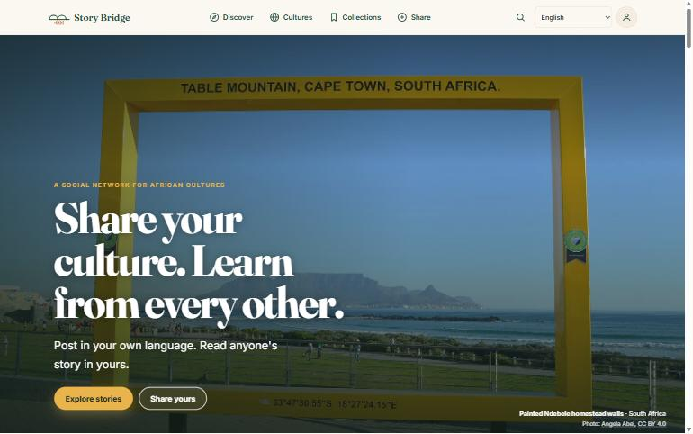
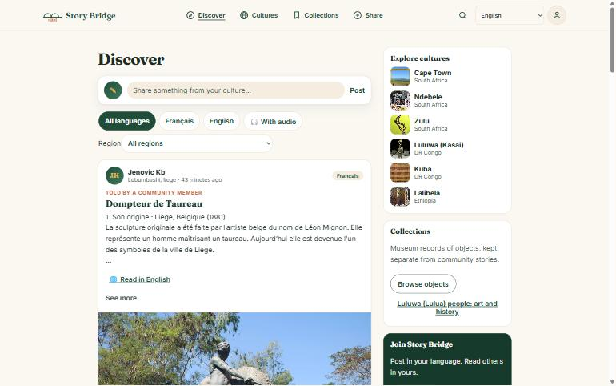
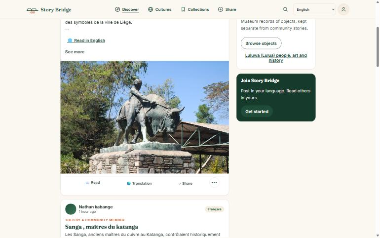
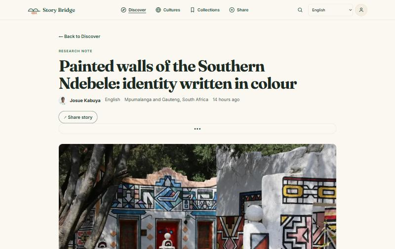
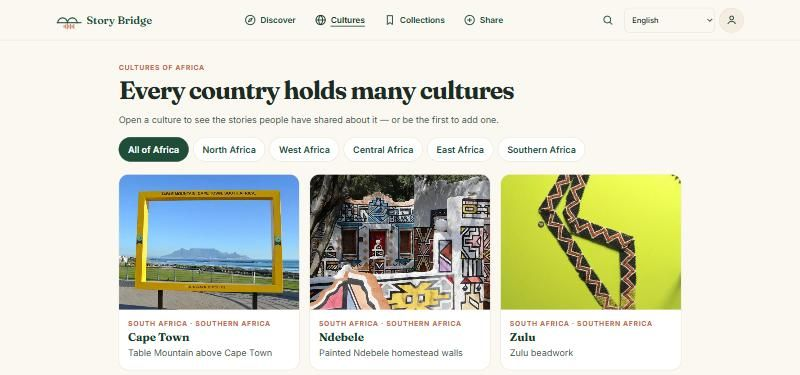
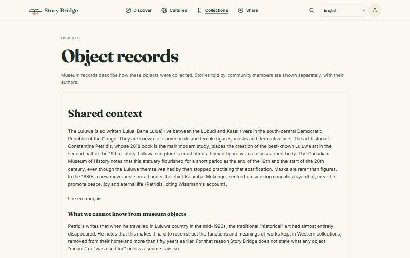
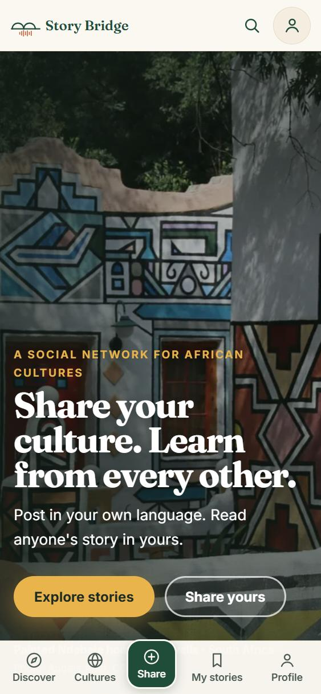

# Story Bridge

**A learning-first social network for African cultures.** People share stories, objects, language, music, traditions and places from their own culture — in their own language and voice — with sources and context underneath. Anyone can read them in their own language, while the original always stays one click away.

**Live demo:** https://story-bridge.onrender.com

Built for the Andela × OpenAI capstone *Telling African Stories*, and to be presented at the Africa Tech Festival (Cape Town).

---

## Screenshots

Captured from the live site on 11 November 2026. These public-view screenshots are a dated snapshot; posts and profile details may change.

<table>
  <tr>
    <td width="50%"><br><sub><b>Home</b> — the public landing page.</sub></td>
    <td width="50%"><br><sub><b>Discover</b> — browse stories with language and audio filters.</sub></td>
  </tr>
  <tr>
    <td><br><sub><b>Feed post</b> — a story card with photo and reading actions.</sub></td>
    <td><br><sub><b>Story detail</b> — original text, author, language, and story documentation.</sub></td>
  </tr>
  <tr>
    <td><br><sub><b>Cultures</b> — browse showcase cultures by region.</sub></td>
    <td><br><sub><b>Culture detail</b> — sourced context, with a language search shortcut.</sub></td>
  </tr>
  <tr>
    <td><br><sub><b>Object records</b> — museum references remain separate from community stories.</sub></td>
    <td align="center"><br><sub><b>Mobile</b> — landing page and bottom navigation.</sub></td>
  </tr>
</table>

## What you can do

- **Discover** a feed of public stories: author, region, time, original language, preserved paragraph breaks in previews, "See more", photos, audio, the storyteller's translation, and sharing.
- **Share** a post in four steps — language → tell → translate → review. A post can hold text, a voice recording or audio file, up to six photos, and documentation: post type and section, region, people, tags, sources, a trust label (*Told by a community member*, *Research note*, *Museum record*) and a licence. Photo credits start with the storyteller's profile name, alt text can be left blank and is filled from the post title, and validation guides the author to the field that needs attention.
- **Translate with AI** (optional): *Draft with AI* asks OpenAI for a first translation. It is marked unapproved until the storyteller approves it, and editing it clears the approval. An empty `OPENAI_TRANSLATION_MODEL` uses `gpt-6-luna`; an optional fallback model is tried once if the provider reports the primary model is missing or access is denied.
- **Read in my language** — storyteller translations are labelled with their language and author; on-device translation in Chrome and the Google Translate link are labelled as machine translation. The machine option is hidden when the author's translation matches the selected interface language.
- **Guard translations** — the author must provide a target language different from the original. A text-similarity check blocks identical or near-identical copies; this is a heuristic, not a translation-quality check.
- **Stay in control**: every story starts as a private draft. The storyteller approves sharing, can withdraw it, or **delete it permanently** (text, audio, photos and translations).
- **Load protected media safely**: members-only, pending and private post photos and recordings use the signed-in session; only public posts with public access use cacheable direct media URLs.
- **Profiles and post identity**: photo, name, country, languages and counts, with an *Edit profile* form. Public stories use the author's current profile name, then a Google account name or stored story name when needed, plus their photo (or initials). Welcome requires a display name, and Share saves a missing name before creating the post. The opt-in *Post as Community member* choice is off by default and tucked under Privacy options.
- **Navigate consistently**: the same app header provides Discover, Cultures, Collections, Share, search, language choice and the account menu. The mobile bar links to My stories with a bookmark icon. The header never displays an email address; the address is inside Profile → Account.
- **Explore cultures and search**: browse showcase cultures by region, open a culture page with credited photos and matching public stories, or search public posts and cultures together. Culture entries contain no invented background facts.
- **Review first posts**: an admin account with access to the pending-post API can publish a first public post or keep it private. The review queue is hidden from other accounts.
- **Read the full story**: open a story with its author label, language, region, relative date, full text, photos and credits, audio, translation origin and sources. Share a public link or return to the list you opened it from.
- **Objects**: four museum reference records for Luluwa (Lulua) objects from DR Congo, each with *What we know*, *What we do not know*, sources, and community questions. Museum records are kept separate from community stories.
- **Read the site in 20 languages**: English and French written by hand; Kiswahili, Hausa, Yorùbá, Igbo, Amharic, Afaan Oromoo, Somali, isiZulu, isiXhosa, Afrikaans, chiShona, Lingála, Ikinyarwanda, Malagasy, Wolof, Portuguese, Arabic (right-to-left) and Spanish as machine drafts, clearly labelled until a speaker checks them. Stories can be written in 36 languages (31 African), or any other language typed by hand.
- **Sign in** with Google or a 6-digit email code. New accounts get a short welcome step.

The app shell and static interface files can be installed as a PWA. Its service worker fetches pages network-first and falls back to the cached shell offline; it caches static resources but never `/api/` responses. Story and account data still require a network connection.

### Honesty rules built into the product

- No invented translations of a person's story: machine translations are labelled, and the original is always available.
- No invented cultural facts: object pages show sourced facts, our readings are marked as such, and unknowns say *Not recorded*.
- Every image carries its author, licence and source.

## Current status (10 November 2026)

| Area | Status |
|---|---|
| Public site, landing page, Discover, objects, profiles, posting, delete | Live and checked on the demo |
| Email-code and Google sign-in | Live. Google OAuth is in *Testing* mode: only accounts added as test users can sign in with Google until the app is published |
| Database migrations `202611070001` … `202611090007` | Applied to the production Supabase project |
| AI translation | Key configured on the host; the live provider call is still being verified (errors are now logged as status/code/model only) |
| Interface translation | Landing page in 20 languages; feed/detail controls in English and French, with other screens falling back to English. Brand and translated navigation opt out of browser auto-translation; story text stays translatable. |
| Phase L0 (live) | Shared navigation, account email privacy, PWA metadata, static asset serving, sitemap and offline shell are deployed. Render serves the pushed build; the live header and static resource types were checked. Signed-in email privacy is covered by the browser suite with synthetic authentication |
| Culture directory and search | Live in the app build; public showcase data only, with no social schema or API changes |
| First-post admin review | Available only to accounts authorized by the pending-post endpoint; publish and keep-private actions are confirmed |
| Responsive and loading review | Lazy-loaded page routes; initial JavaScript is about 158 kB gzip. Twenty screens were captured at 375, 768 and 1280 px with no horizontal overflow, clipped text, undersized controls or browser console issues in the synthetic review. |
| Phase L1 social schema | Migration `202611090007_social_layer.sql` is applied in production |

On phones, feed cards appear at full contrast immediately. Named authors keep initials visible while profile photos load or when a photo is unavailable, and the landing hero updates its caption only after the matching photo is ready.

This is a demonstration build, not a production service for sensitive stories or recordings.

## Safety and moderation

- New members' first posts wait for moderator review before becoming public. Signed-in members can report a post; reports are private to the moderator, who can dismiss a report or hide the post. A hidden post becomes private and withdrawn, and its moderator note appears in My stories.
- Production reports use the social schema from migration `202611090007_social_layer.sql` (applied by the owner on 11 November 2026).
- Follow the [community guidelines](/guidelines): share only what you have permission to share, respect sacred or restricted knowledge, avoid personal information and harassment, and credit sources and images.
- Members can delete their account from Profile after confirming by typing `DELETE`. This removes the profile, posts and stored files; it cannot remove copies already downloaded by others.
- Data processors listed in the [Privacy notice](/privacy): Supabase provides the database, file storage and sign-in; Render hosts the app; Google is used for optional Google sign-in and Google Fonts; OpenAI receives story text only when an author requests an AI translation draft; Google receives text only if a reader clicks the external Google Translate link.

## Tech stack

React + Vite (frontend), Express (API), Supabase (Auth, Postgres with row-level security, private storage), OpenAI Responses API (optional translation drafts), Render (hosting).

```
src/
  App.jsx                 entry point
  state/                  application state and routing
  pages/                  screens (Landing, Discover feed, Share, Review, Profile, Objects…)
  components/             audio player and previews
  lib/                    api.js (session headers), i18n.js, languages.js (language registry)
  locales/                interface text, one JSON file per language
  data/                   showcase cultures and generated image credits
  styles/                 tokens, base and per-screen CSS
server/                   Express API, auth (JWT/JWKS), stores (Supabase or file), CSP
supabase/migrations/      SQL migrations (review before applying)
scripts/                  image fetching, tests, secret check
docs/                     collaboration board, phase plan, object documentation, credits
```

Pages have real URLs: `/discover`, `/stories/:id`, `/profile`, `/mine`, `/share`, `/objects`, `/objects/:id`, `/cultures`, `/cultures/:id`, `/search` and `/admin`. Direct links and reloads work, signed in or not; private pages show the sign-in screen when no one is signed in. Admin review appears only after the signed-in user's pending-post request returns 200. Notifications are not implemented, so no `/notifications` route is registered.

## Run locally

Requires Node.js 24.x and npm.

```sh
npm ci
npm run dev
```

Open `http://localhost:5173`. The API listens on `127.0.0.1:3000`.

The server reads the ignored project-root `.env` before choosing its mode; process environment values take precedence. Values are trimmed, and a UTF-8 BOM or an inline ` # comment` is ignored. Restart the server after editing `.env`.

### Local file mode

```dotenv
STORY_BACKEND=file
STORY_AUTH_MODE=legacy
```

Stories are stored in `data/stories.json` and recordings in `uploads/`. The browser keeps an owner token in localStorage. This mode has no account sign-in and is refused by the production entry point. `npm run seed` creates six fictional public stories (it refuses to overwrite existing data).

### Supabase account mode

Use `.env.example` as a template:

```dotenv
STORY_BACKEND=supabase
STORY_AUTH_MODE=account
SUPABASE_URL=https://YOUR_PROJECT.supabase.co
SUPABASE_PUBLISHABLE_KEY=YOUR_PUBLISHABLE_KEY
SUPABASE_SECRET_KEY=YOUR_SERVER_ONLY_SECRET_KEY
SUPABASE_BUCKET=story-bridge-audio
STORY_EMAIL_CODE_SIGN_IN=true
STORY_GOOGLE_SIGN_IN=false
OPENAI_API_KEY=             # optional, server-only, never prefix with VITE_
OPENAI_TRANSLATION_MODEL=   # optional, defaults to gpt-6-luna
OPENAI_TRANSLATION_FALLBACK_MODEL= # optional, server-only; retry once on missing model/access denial
STORY_BRIDGE_OBJECT_ADMIN_ID= # Supabase user id allowed to approve first posts
RESEND_API_KEY=                # optional, server-only; Resend API key for admin alerts
NOTIFY_FROM=                   # optional, server-only; verified Story Bridge sender
ADMIN_NOTIFY_EMAIL=            # optional, server-only; admin alert recipient
```

| Variable | Required | Scope | Purpose |
|---|---|---|---|
| `RESEND_API_KEY` | Optional; all three alert values are required together | Server only | Authenticates admin alert requests to Resend |
| `NOTIFY_FROM` | Optional | Server only | Verified Story Bridge sender address |
| `ADMIN_NOTIFY_EMAIL` | Optional | Server only | Receives first-post, report, welcome and test alerts |

`SUPABASE_URL` and the publishable key are browser-safe. `SUPABASE_SECRET_KEY`, `OPENAI_API_KEY`, and the Resend alert settings are server-only: never commit their values or expose them to the frontend. Admin alerts are silently disabled unless all three Resend settings are present.

For a new Supabase project:

1. Review, then apply every file in `supabase/migrations/` in order. See [docs/migrations.md](docs/migrations.md).
2. Configure email sign-in with a template that includes `{{ .Token }}`. Set *Email OTP length* to 6 (the code screen has six boxes).
3. Set the Site URL and redirect URLs for your local and deployed origins (for example `http://localhost:5173/**` and `https://your-domain/**`).
4. For Google: create an OAuth client whose redirect URI is `https://YOUR_PROJECT.supabase.co/auth/v1/callback`, enable the Google provider in Supabase, then set `STORY_GOOGLE_SIGN_IN=true`.

Missing or invalid account configuration stops server startup; it never silently falls back to local storage.

### Landing-page photos

`npm run images:fetch` downloads the landing-page photos from Wikimedia Commons. It accepts only public domain, CC0, CC BY and CC BY-SA files without personality-rights restrictions, skips files that describe people, re-encodes to WebP without metadata, and writes `src/data/africa-images.json` and `docs/image-manifest.json` with author, licence and source for each image. Review the manifest before publishing.

The Zulu culture card uses a locally bundled, metadata-free CC0 photo of a beaded necklace, credited to Daderot; it shows the object without a person.

## Deploy

Set the account-mode variables in the host's private environment settings (on Render: *Environment*), then:

```sh
npm ci && npm run build
npm start
```

`npm start` forces production mode and serves `dist/`. Use the host's `PORT`, set `HOST=0.0.0.0` when needed, and serve over HTTPS. `STORY_TRUST_PROXY=1` enables proxy-aware IP handling behind a trusted proxy; `STORY_HTTPS=1` enables HSTS.

After deploying, check `/api/account/config` (`google` and `email` flags), sign in, save and delete a draft, and try *Draft with AI*.

## Tests

```sh
npm test                      # backend and unit tests
npx playwright install chromium
npm run test:all              # build + backend + browser tests + secret check
npm run test:screens          # screenshots at 375, 768 and 1280 px
npm run check:dist-secrets    # narrow check for configured secrets in source and build
```

Browser tests use isolated data under `.test-data/` and save evidence under `test-evidence/`; they never touch `data/` or `uploads/`. Authentication in tests uses local keys and a mocked provider: automated tests do not prove that a real Supabase, email, Google or OpenAI configuration works.

## Quality

Lighthouse scores from the live site on 10 November 2026 (Performance / Accessibility / Best Practices / SEO, each out of 100):

| Page | Desktop | Mobile |
|---|---:|---:|
| Home | 55 / 97 / 100 / 92 | 55 / 96 / 100 / 92 |
| Discover | 55 / 96 / 100 / 100 | 54 / 96 / 100 / 92 |

Full HTML and JSON reports, including Search and story detail, are in [`docs/quality/`](docs/quality/).

## Privacy, security and limits

- Account stories belong to verified Supabase user ids. Tokens are checked for signature, issuer, audience and expiry. The Supabase session lives in browser localStorage and is sent to the API as a bearer token; a strict Content Security Policy limits script sources.
- Drafts, private, withdrawn and nonexistent stories all return the same 404 to anyone but the owner. Hidden storyteller names are removed from public responses. Private files are served through the API, never through public storage URLs. The profile photo is fetched with the session token.
- Uploaded images are checked by file signature, re-encoded to WebP (up to 1600 px) and stripped of metadata. Audio uploads are limited to 10 MiB; each account is limited to 500 stories and 1 GiB of audio.
- Deleting a story removes its text, audio, photos and media records. Deleting an account also removes its stories, audio and post photos.
- Write requests are rate-limited per client IP (default 60 per 60 s; `STORY_WRITE_RATE_LIMIT`, `STORY_WRITE_RATE_WINDOW_MS`).
- The AI translation request sends the story to OpenAI only when the storyteller presses *Draft with AI*. Server logs record only the provider status, error code and model — never the key or the story.
- These controls and the automated tests are not a security audit.

## Image and content credits

- Landing-page photos: author, licence and source for each image are listed in the site footer (*Image credits*) and in [docs/image-manifest.json](docs/image-manifest.json).
- Luluwa object photos and records: [docs/credits.md](docs/credits.md) and [docs/object-documentation.md](docs/object-documentation.md).

## Known limits / roadmap

- Video posts are not supported yet; **Profile bio (planned)**.
- Sharing with selected people or groups is not available; stories can be private or public.
- AI translation drafts need OpenAI configured with available credit; reader-side “Read in my language” works without it.
- Microphone recording still needs a real-device test.

## Project origin

Created by Josué Kabuya (Grand Kasaï, DR Congo), who set the vision, product direction and content. The code, documentation and tests were developed with AI coding assistants working under his direction. Design decisions, iterations and test reports are recorded in [PLAN.md](PLAN.md), [docs/COLLAB.md](docs/COLLAB.md), [REVIEW.md](REVIEW.md) and [TEST-REPORT.md](TEST-REPORT.md).
