# Story Bridge

<p align="center"></p>

<p align="center"><strong>Share your culture. Learn from every other.</strong><br>
A social network where people share stories from their cultures in their own language, with context, credit and control.</p>

<p align="center"><a href="https://story-bridge.onrender.com">Open the live app</a> · <a href="https://github.com/josuekb09/Story-Bridge">View the source</a></p>

## Demo video

<p align="center"></p>

**YouTube placeholder:** the video link will be added after the owner selects a cut. A five-minute review video is ready locally; it is not published in this repository while that choice is pending.

## The problem

African cultural knowledge is held by families and communities, often passed on orally and in languages that receive little support online. Stories are too often written about people rather than by them, separated from their sources, or presented without the voices of the people they belong to. Museum records can describe an object's collection history while leaving its community context unknown.

## What it does

The project brings together three named challenge tracks and a fourth product strand for consent and safety:

### Voices & Languages

People can write, record audio or add photos about stories, objects, songs, traditions and places in one of 36 suggested languages, including 31 African languages. The original stays intact. Authors may add their own translation or request an AI draft when OpenAI is configured; machine-drafted interface text and translations are labelled for readers.

### Truth, Authorship & Ownership

Posts can include people, region, tags, sources, photo credits, licence and a trust label such as a community story or research note. A story record tracks versions. Authors choose an audience and can withdraw or delete their work.

### Discovery & Audience

Discover has language and audio filters. Search brings public stories and culture entries together; culture pages show related stories and country languages. Museum object records stay separate from community stories and identify what is known, what is uncertain and what sources support the record.

### Consent & Community Safety

Stories can be public, members-only or private. A new member's first post is reviewed before publication. Readers can report a post; moderators can hide it. Terms, Privacy and Community Guidelines explain the rules, and account deletion is available.

## Screenshots

These public-view captures were made from the live site on 11 November 2026 at 1440×900 with device scale 2, and at 390×844 with device scale 2 for mobile. The public feed contained eight posts at capture time; all eight are shown below. Six consecutive panels make up the full Discover feed, and three panels make up the complete culture directory. Every screenshot is linked to its full-size JPEG. No private or members-only content was captured.

### Home & languages

<table>
  <tr>
    <td><a href="docs/screenshots/01-home-hero.jpg"></a><br><sub>Home hero and live visual identity.</sub></td>
    <td><a href="docs/screenshots/02-how-it-works.jpg"></a><br><sub>How it works: tell, document and share.</sub></td>
  </tr>
  <tr>
    <td><a href="docs/screenshots/03-home-cultures.jpg"></a><br><sub>Culture cards on the home page.</sub></td>
    <td><a href="docs/screenshots/04-home-counters.jpg"></a><br><sub>Live counters and latest stories.</sub></td>
  </tr>
  <tr>
    <td><a href="docs/screenshots/05-home-languages.jpg"></a><br><sub>Languages for writing and reading.</sub></td>
    <td><a href="docs/screenshots/23-cultures-directory-01.jpg">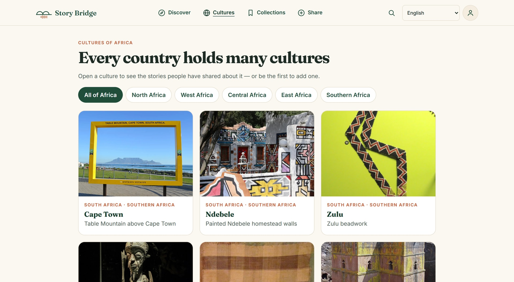</a><br><sub>Culture directory, panel 1 of 3.</sub></td>
  </tr>
  <tr>
    <td><a href="docs/screenshots/23-cultures-directory-02.jpg">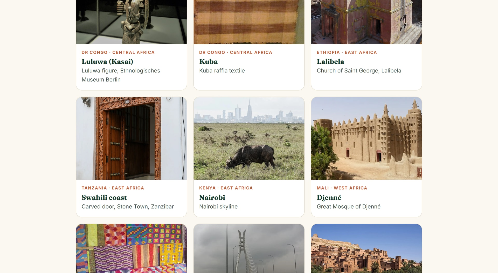</a><br><sub>Culture directory, panel 2 of 3.</sub></td>
    <td><a href="docs/screenshots/23-cultures-directory-03.jpg">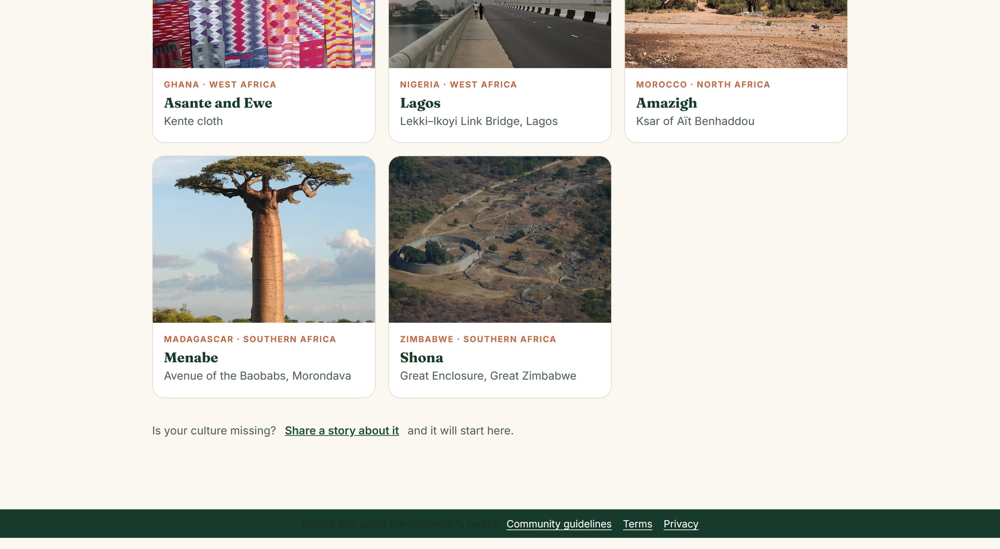</a><br><sub>Culture directory, panel 3 of 3.</sub></td>
  </tr>
</table>

#### Culture pages

<table>
  <tr>
    <td><a href="docs/screenshots/24-zulu-culture.jpg">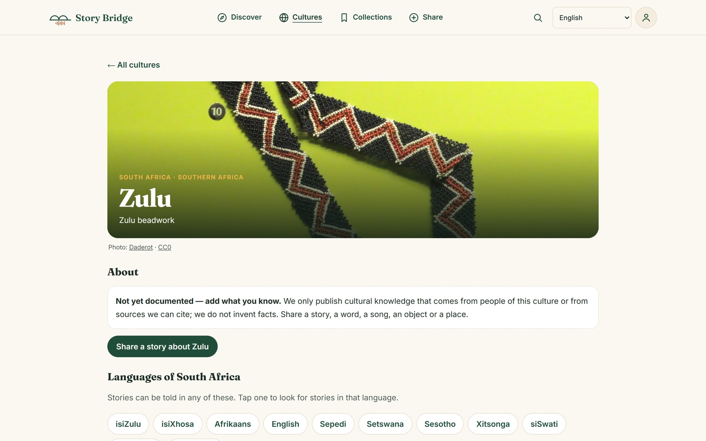</a><br><sub>Zulu culture page.</sub></td>
    <td><a href="docs/screenshots/25-zulu-culture-stories.jpg">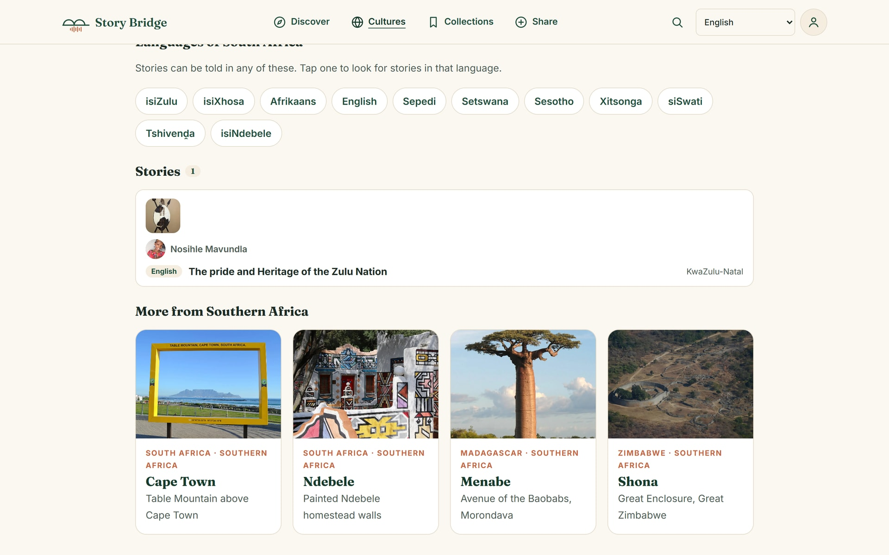</a><br><sub>Zulu culture page and related public story.</sub></td>
  </tr>
  <tr>
    <td><a href="docs/screenshots/26-ndebele-culture.jpg"></a><br><sub>Ndebele culture page.</sub></td>
    <td><a href="docs/screenshots/27-ndebele-culture-stories.jpg">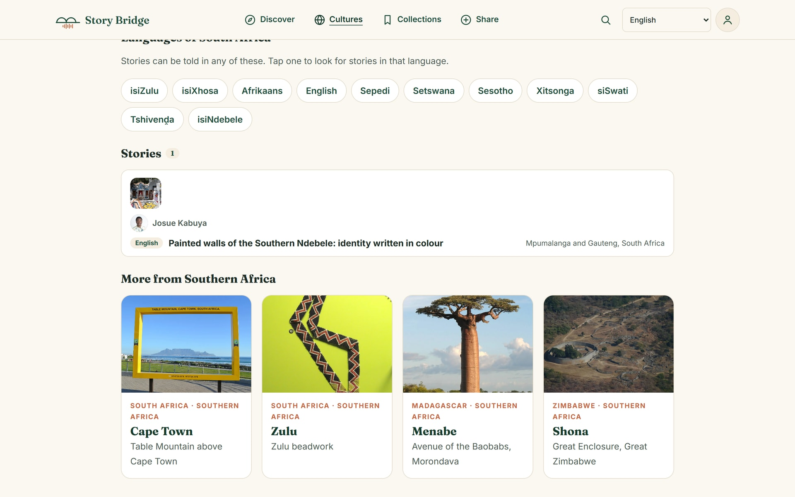</a><br><sub>Ndebele culture page and related public research note.</sub></td>
  </tr>
</table>

### Stories from real members: Zulu, Congo, Lesotho and Zimbabwe

The first six images below are consecutive panels of Discover, from top to bottom, showing the complete public feed as it appeared during capture.

<table>
  <tr>
    <td><a href="docs/screenshots/06-discover-full-feed-01.jpg"></a><br><sub>Discover, full feed panel 1 of 6.</sub></td>
    <td><a href="docs/screenshots/06-discover-full-feed-02.jpg"></a><br><sub>Discover, full feed panel 2 of 6.</sub></td>
  </tr>
  <tr>
    <td><a href="docs/screenshots/06-discover-full-feed-03.jpg"></a><br><sub>Discover, full feed panel 3 of 6.</sub></td>
    <td><a href="docs/screenshots/06-discover-full-feed-04.jpg"></a><br><sub>Discover, full feed panel 4 of 6.</sub></td>
  </tr>
  <tr>
    <td><a href="docs/screenshots/06-discover-full-feed-05.jpg"></a><br><sub>Discover, full feed panel 5 of 6.</sub></td>
    <td><a href="docs/screenshots/06-discover-full-feed-06.jpg"></a><br><sub>Discover, full feed panel 6 of 6.</sub></td>
  </tr>
  <tr>
    <td><a href="docs/screenshots/12-zulu-nosihle.jpg">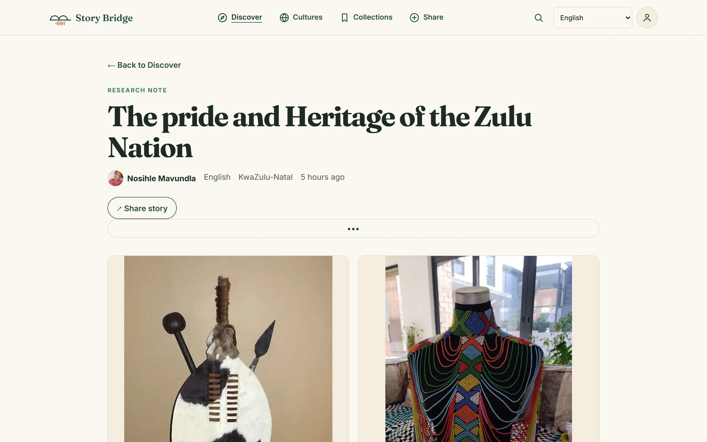</a><br><sub>Nosihle Mavundla — <em>The pride and Heritage of the Zulu Nation</em>.</sub></td>
    <td><a href="docs/screenshots/13-ndebele-erwin.jpg">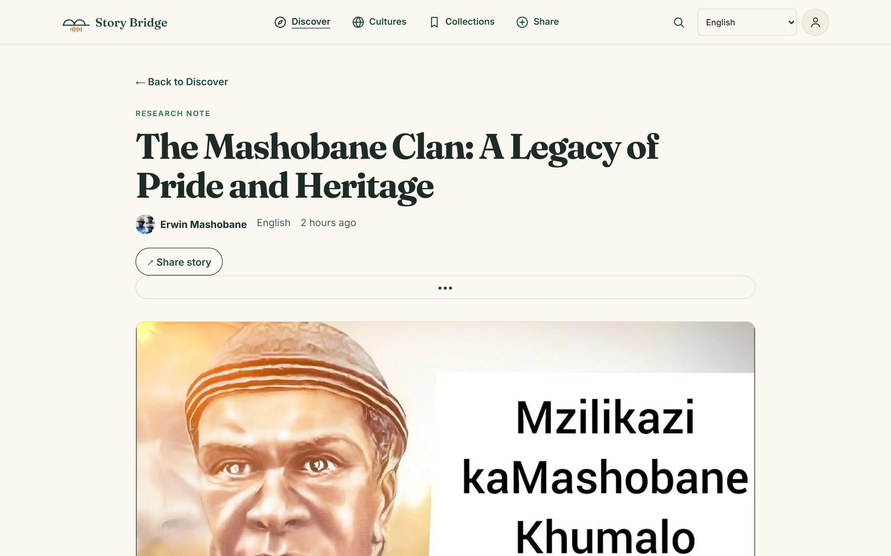</a><br><sub>Erwin Mashobane — <em>The Mashobane Clan: A Legacy of Pride and Heritage</em>.</sub></td>
  </tr>
  <tr>
    <td><a href="docs/screenshots/14-lesotho-scarlet.jpg"></a><br><sub>Scarlet — <em>Kobo ya Sesotho</em>.</sub></td>
    <td><a href="docs/screenshots/15-congo-jenovic.jpg"></a><br><sub>Jenovic Kb — <em>Dompteur de Taureau</em>, Lubumbashi.</sub></td>
  </tr>
  <tr>
    <td><a href="docs/screenshots/16-congo-nathan.jpg"></a><br><sub>Nathan Kabange — <em>Sanga, maîtres du Katanga</em>.</sub></td>
    <td><a href="docs/screenshots/17-congo-lwamba.jpg"></a><br><sub>Lwamba Moket Dan — <em>Monument de l'identité Katangaise</em>.</sub></td>
  </tr>
  <tr>
    <td><a href="docs/screenshots/18-ndebele-josue.jpg">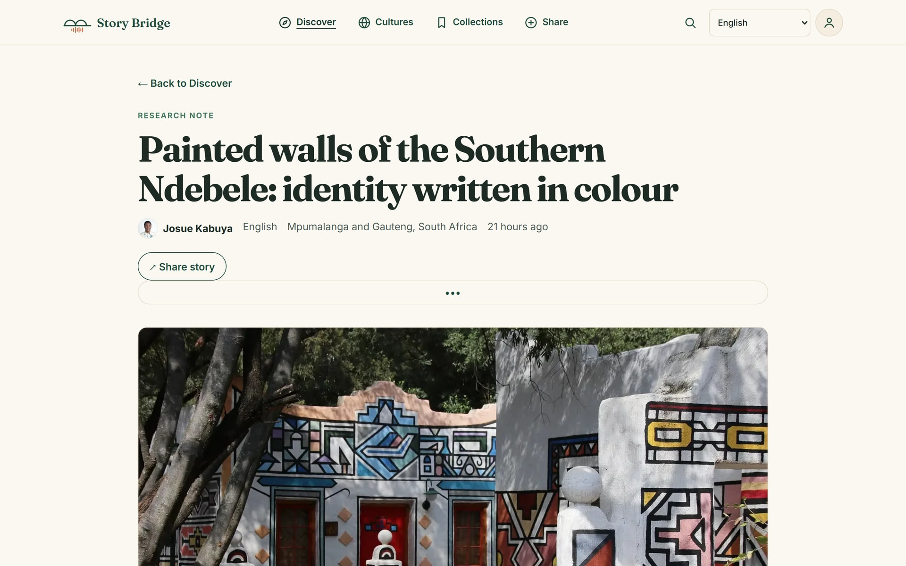</a><br><sub>Josue Kabuya — <em>Painted walls of the Southern Ndebele</em>.</sub></td>
    <td><a href="docs/screenshots/19-zimbabwe-samantha.jpg">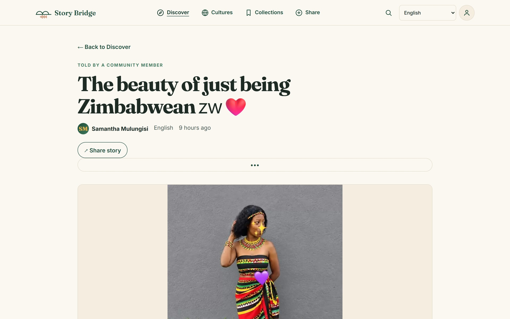</a><br><sub>Samantha Mulungisi — <em>The beauty of just being Zimbabwean</em>.</sub></td>
  </tr>
</table>

### Documentation & objects

<table>
  <tr>
    <td><a href="docs/screenshots/20-ndebele-reader-control.jpg">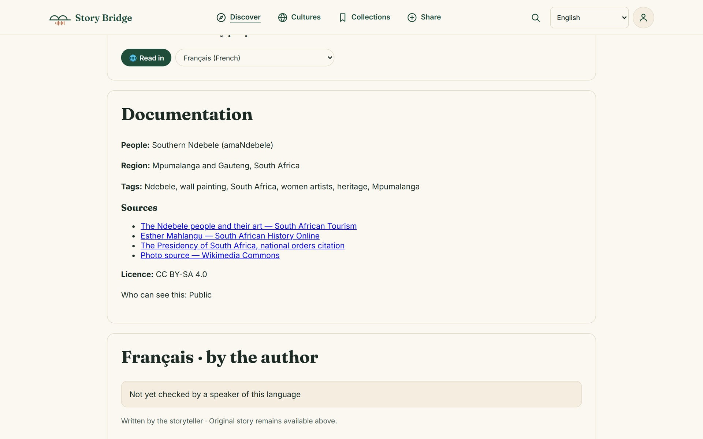</a><br><sub>Reader-side “Read in” control on a public Ndebele story.</sub></td>
    <td><a href="docs/screenshots/21-ndebele-documentation-sources.jpg">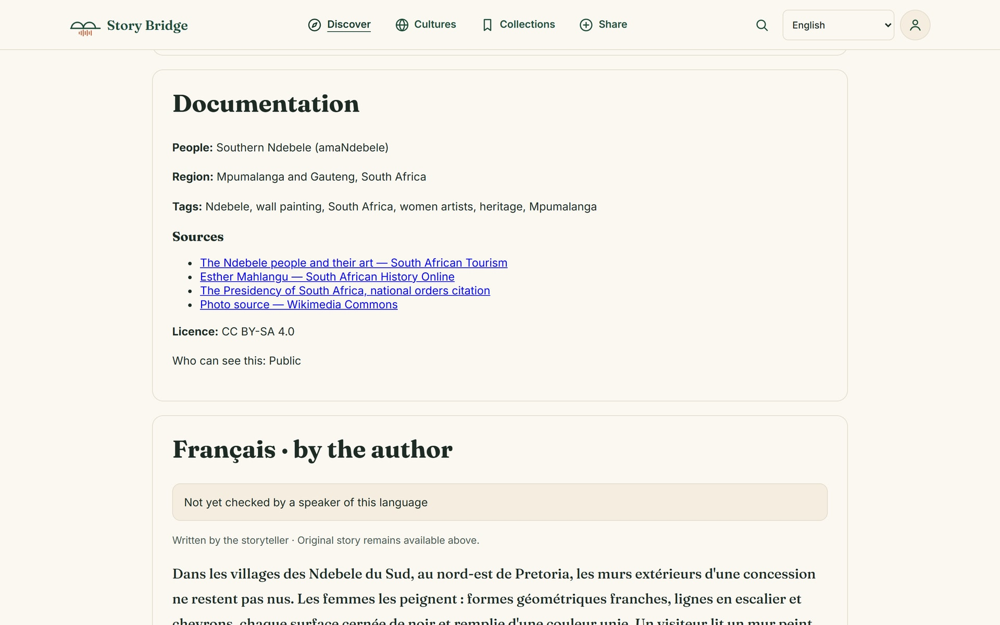</a><br><sub>Story documentation and sources.</sub></td>
  </tr>
  <tr>
    <td><a href="docs/screenshots/22-ndebele-author-translation.jpg">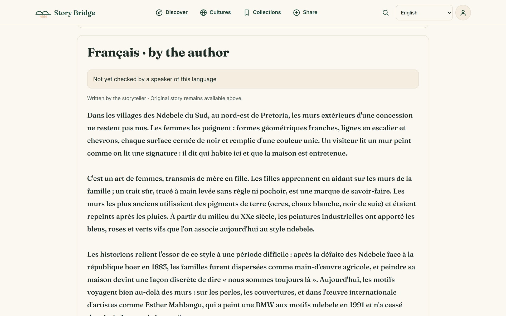</a><br><sub>Author-written French translation, labelled for review.</sub></td>
    <td><a href="docs/screenshots/28-berlin-object-record.jpg"></a><br><sub>Berlin statue: a separate museum record with image credit and object details.</sub></td>
  </tr>
  <tr>
    <td colspan="2"><a href="docs/screenshots/29-read-in-my-language-live-unavailable.jpg">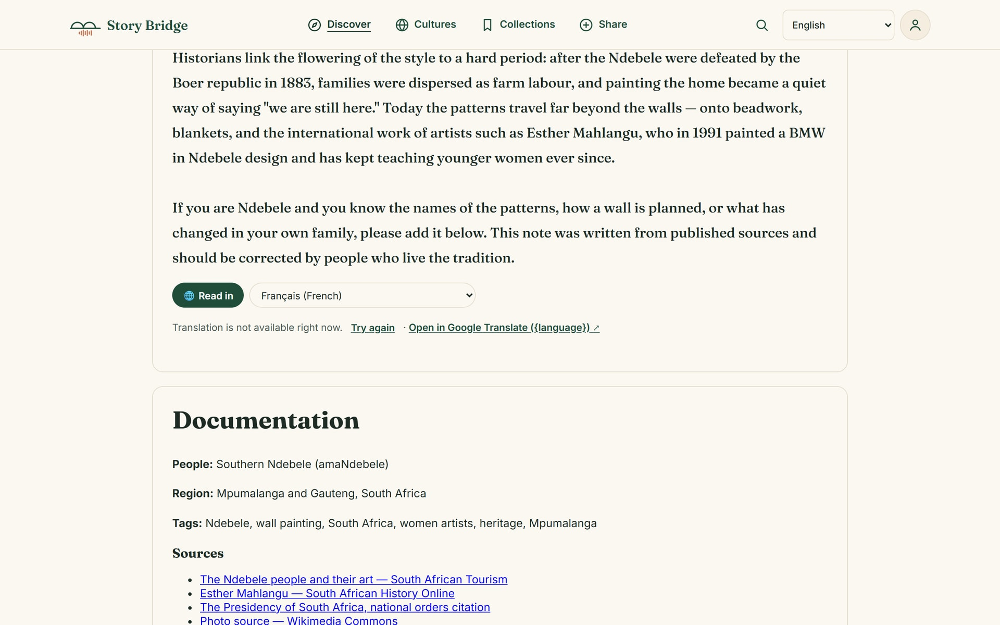</a><br><sub>Live translation check: the production endpoint returned “Translation is not available right now” during capture; the original and author translation remain available.</sub></td>
  </tr>
</table>

### Safety & rights

<table>
  <tr>
    <td><a href="docs/screenshots/30-signed-out-share-sign-in.jpg">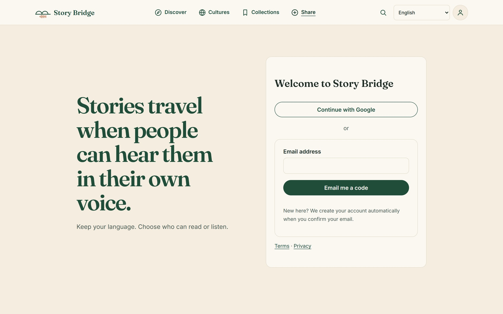</a><br><sub>Share opens sign-in for a signed-out visitor.</sub></td>
    <td><a href="docs/screenshots/31-community-guidelines.jpg">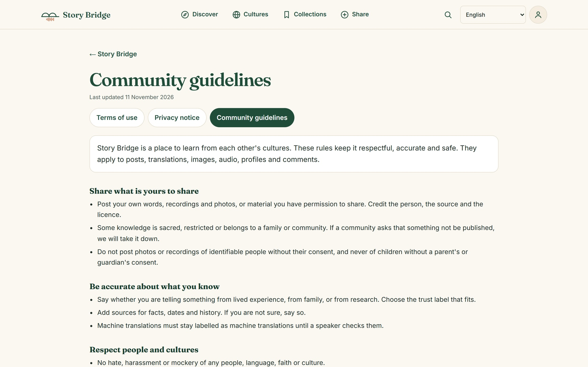</a><br><sub>Community Guidelines.</sub></td>
  </tr>
  <tr>
    <td><a href="docs/screenshots/32-terms.jpg">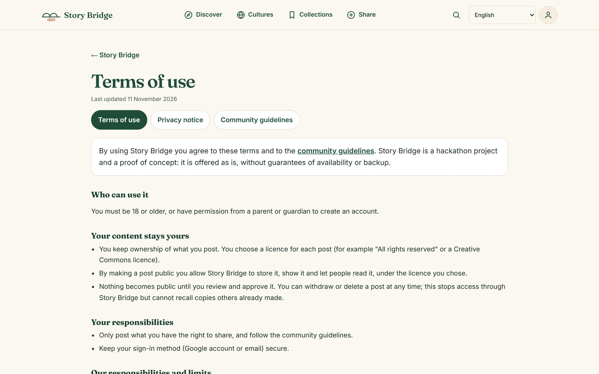</a><br><sub>Terms.</sub></td>
    <td><a href="docs/screenshots/33-privacy.jpg">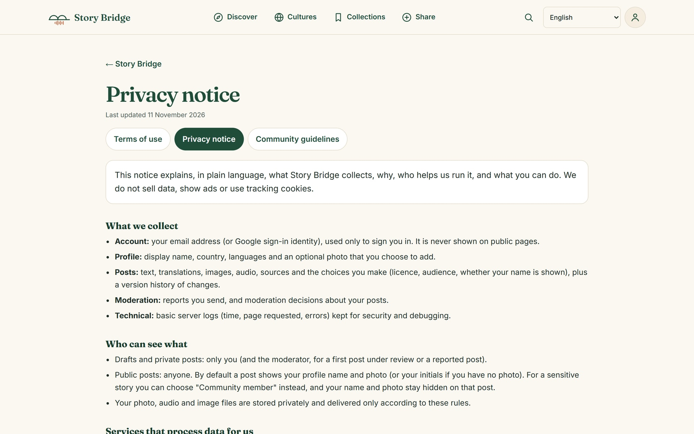</a><br><sub>Privacy notice.</sub></td>
  </tr>
</table>

### Mobile

<table>
  <tr>
    <td><a href="docs/screenshots/34-mobile-home.jpg">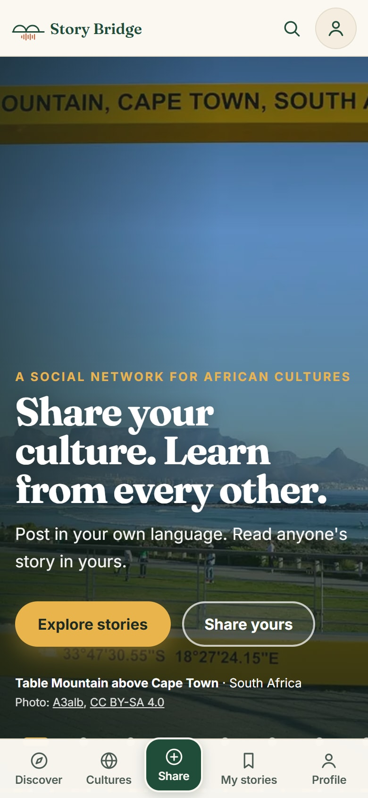</a><br><sub>Home at 390×844.</sub></td>
    <td><a href="docs/screenshots/35-mobile-post.jpg"></a><br><sub>A public story at 390×844.</sub></td>
    <td><a href="docs/screenshots/36-mobile-share.jpg">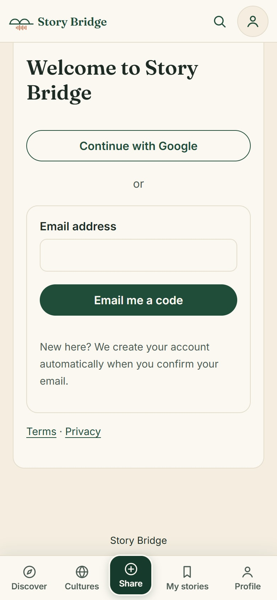</a><br><sub>Share sign-in at 390×844.</sub></td>
  </tr>
</table>

## How it works

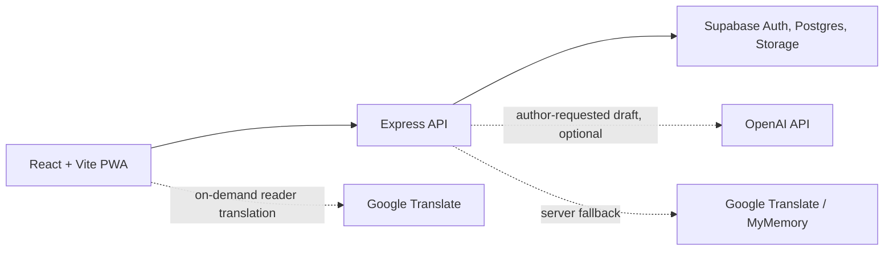

The browser contains the public interface and sends account requests to the server. Express checks sessions and applies access rules before using Supabase. OpenAI is used only when an author asks for a translation draft and the server has a configured key. Reader translation calls Google Translate from the browser first, with the server endpoint as a fallback; the original story is retained and the result is labelled as machine translation.

## Run locally

Requires Node.js 24.x and npm.

```sh
npm ci
npm run dev
```

Open `http://localhost:5173`. For account mode, place local settings in an ignored `.env` file. Never commit secret values. The project also has a local file mode for development; it is not the production account store.

## Environment variables

Names only; configure values locally or in the deployment host's private settings.

```text
STORY_BACKEND
STORY_AUTH_MODE
SUPABASE_URL
SUPABASE_PUBLISHABLE_KEY
SUPABASE_SECRET_KEY
SUPABASE_BUCKET
STORY_EMAIL_CODE_SIGN_IN
STORY_GOOGLE_SIGN_IN
OPENAI_API_KEY
OPENAI_TRANSLATION_MODEL
OPENAI_TRANSLATION_FALLBACK_MODEL
STORY_BRIDGE_OBJECT_ADMIN_ID
RESEND_API_KEY
NOTIFY_FROM
ADMIN_NOTIFY_EMAIL
HOST
PORT
STORY_TRUST_PROXY
STORY_HTTPS
STORY_WRITE_RATE_LIMIT
STORY_WRITE_RATE_WINDOW_MS
```

## Moderation & privacy

- Authors choose whether a story is public, members-only or private. A first public post waits for moderator review.
- Signed-in readers can report a post. Moderators can hide or dismiss reports; the report does not reveal the reporter to the author.
- Story owners can withdraw or permanently delete posts. Account deletion removes the profile, posts and associated files.
- Account sessions are verified by the server. Supabase row-level security protects account data; private media is served through authenticated API routes.
- Uploaded images are re-encoded and stripped of embedded metadata. Each story can show its sources, photo credit and licence.

## Known limits

- Video posts are not supported yet; profile bio is planned.
- Sharing with selected people or groups is not available yet. The current choices are public, members-only and private.
- AI translation drafts require OpenAI configuration and available API credit.
- Reader-side translation works in the reader’s browser and is labelled as machine translation. The server fallback may be unavailable when translation providers reject the deployment host’s outbound requests.
- Machine-drafted interface languages still need review by speakers. The microphone workflow still needs a real-device test.

## Credits

Designed by Josue Kabuya. Built with OpenAI Codex.
